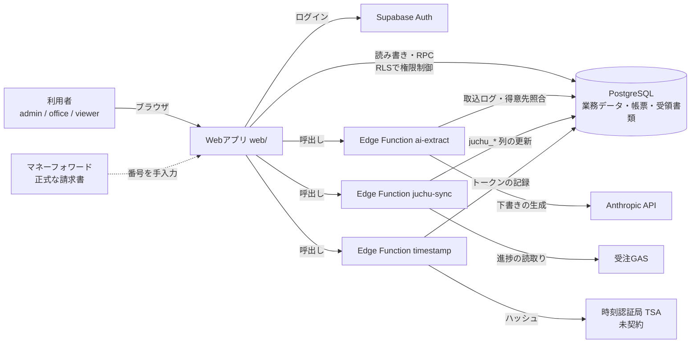

# システム概要書 — CROSSTECH 統合販売管理システム（crosstech-erp）

| 項目 | 内容 |
|---|---|
| 作成日 | 2026-10-31 |
| 対象 | 株式会社クロステック 統合販売管理システム（自社開発。Claude Code で開発） |
| 位置づけ | 電子帳簿保存法施行規則第2条第2項第1号イ「電子計算機処理システムの概要を記載した書類」。取扱通達4-6(1)のとおり、**システム全体の構成と各システム間のデータの流れなど、処理過程を総括的に記載**する |
| 更新ルール | スキーマ・機能を変えたときは、この書類の該当箇所と §9（変更履歴）を同じ変更で更新する（CLAUDE.md §3-9） |
| 備付けの方法 | リポジトリ（GitHub）の `docs/` に置き、画面・書面に速やかに出力できる状態で備え付ける（書面以外の備付けは、取扱通達4-6のなお書で認められる） |
| 他の関係書類 | `docs/システム関係書類一覧.md`（仕様書、操作マニュアル、事務手続の書類との対応と、未作成のもの） |

> 国税庁の一次資料の確認結果と、未確認の事項は `docs/電帳法対応方針.md` を参照。

## 1. システムの目的と範囲

- **目的**: ワイヤー放電加工の **見積 → 受注 → 分納 → 締め請求 → 入金** を一つのデータベースで管理し、帳票（見積書・納品書・請求書）の発行と、受領した書類（請求書・領収書など）の保存を、電子帳簿保存法の要件に沿って行う。
- **範囲に含むもの**: 得意先・外注先マスタ、案件・品目、分納、締め請求、入金と消込、帳票の発行・固定・交付記録、受領書類（電子取引・スキャナ保存）、タイムスタンプの記録、税区分と税率、AIによる案件の下書き、受注・生産管理システムの進捗の読取り。
- **範囲外**: 会計帳簿（仕訳帳・総勘定元帳）は会計ソフト側。**正式な請求書は当面マネーフォワードが発行**し、ERPの請求書は控え・社内用（MFの請求書番号を `invoices.mf_invoice_no` に控えるのみ。自動連携はしない）。
- **未実装**（CLAUDE.md §6）: メール作成（mailto）、設定画面（自社情報・スタッフ・請求書の控え／正式の切替）、送付PDFのサーバー側生成。

## 2. システム全体の構成

### 2.1 構成要素
| 区分 | 構成要素 | 役割 | 場所・使用技術 |
|---|---|---|---|
| 画面 | Webアプリ（SPA） | 利用者の操作画面。**金額を計算して保存しない**（表示のみ） | `web/`。Vite、React 19、TypeScript。静的ファイルとして配信（配信先は**未決定**） |
| データベース | PostgreSQL（Supabase） | 全データの保存、**金額計算・整合性チェック・採番・帳票の固定・改ざん防止**をSQL関数とトリガーで実行 | `supabase/migrations/`（16本）。RLS（行単位のアクセス制御）で権限を制御 |
| 認証 | Supabase Auth | メールアドレスとパスワードでログイン。ログインしたユーザーが `staff` に登録されている場合のみ業務データに触れる | Supabase の機能 |
| サーバー処理 | Edge Function `ai-extract` | メール本文・注文書PDFから案件の下書きを作る（保存しない） | `supabase/functions/ai-extract/`（Deno） |
| | Edge Function `juchu-sync` | 受注システムの進捗（加工完了・出荷）を製番で読み取り、品目に反映 | `supabase/functions/juchu-sync/` |
| | Edge Function `timestamp` | 受領書類・送付PDFのハッシュにタイムスタンプ（RFC 3161）を付与して記録 | `supabase/functions/timestamp/` |
| 外部サービス | Anthropic API | AIによる下書きの生成（既定は Haiku、PDF・難しい入力は Sonnet） | `ai-extract` から呼出し。結果は人が確認してから保存 |
| | 受注・生産管理システム（HTML＋GAS＋Drive） | 加工現場の受注・進捗。**ERPからは読み取りのみ** | `juchu-sync` が GAS の URL（secret）を読む |
| | 時刻認証局（TSA） | タイムスタンプの付与 | **認定事業者は未契約**（`docs/タイムスタンプ事業者の比較.md`） |
| | MF クラウドBox | 受領した書類・送付したPDFの保存（電子帳簿保存法の対象ファイルとして） | **メール取込**（Box の取込用アドレスへ、添付つきのメールを送る）。連携のAPIは使わない。設定にアドレスを登録 |
| | MF クラウド請求書 | （契約中。今後の扱いは未定）。ERPの請求書を正式にする場合、MFの番号の控えは不要 | 連携なし |
| ソース管理 | GitHub | ソース・設計書・変更履歴の管理 | `mazo963/crosstech-erp` |

### 2.2 構成図

Edge Function は、利用者のログイン情報（JWT）で DB に接続する。したがって、画面から直接操作する場合と同じ権限制御（RLS）が、そのまま適用される。

## 3. 各システム間のデータの流れ

| # | 業務 | 流れ | 主なデータ・関数 |
|---|---|---|---|
| 1 | **案件の登録** | 画面 →（任意）AI取込 → DB | `projects`、`project_items`。案件番号 `CRO2610xx` と製番 `案件番号-行番号` は DB が採番（`next_doc_no`、トリガー） |
| 2 | **AI取込** | 画面 → `ai-extract` → Anthropic API → 下書きを画面へ返す。**人が確認して保存** | `ai_extractions`（モデル・トークン数・結果。月間上限で停止） |
| 3 | **分納・全数納品** | 画面 → `record_delivery`（数量を指定）／`deliver_all`（残りの全数量）→ DB | `deliveries`、`delivery_lines`。**納品日時点の税区分・税率を納品行に固定**（`tax_rate_on`）。納品書番号 `DN2610-0001` を採番 |
| 4 | **請求書の作成** | 画面 → `create_invoice`（締め請求）／`create_invoice_for_project`（案件単位）／`create_invoice_for_delivery`（納品単位）→ 共通の `create_invoice_core` → DB | `invoices`、`invoice_lines`、`invoice_tax_summary`。未請求の納品行を集め、**税率ごとに集計し、税率ごとに1回だけ端数処理**。請求書番号 `INV2610-0001` |
| 5 | **発行・取消** | `issue_invoice`、`void_invoice`、`void_delivery` | 状態の変更。取消は削除せず `void` で残す |
| 6 | **入金** | 画面 → `record_payment`（銀行振込は入金銀行・口座番号が必須）→ 古い請求書から自動で消込 | `payments`、`payment_allocations`。取消は `void_payment`（行は残り、残高から除外） |
| 7 | **帳票の発行** | 画面 → `issue_document` → 内容を固定して保存 → 表示・印刷（固定した内容から描画） | `issued_documents`（内容、SHA-256、版、取引年月日・金額・取引先）。内容が変われば新しい版、旧版は残る |
| 8 | **帳票のPDF生成・送付・交付の記録** | 画面で固定した内容からPDFを生成（ブラウザ上。`docPdf.ts`、日本語フォント埋め込み。同じ内容なら同じバイト列）→ お客様宛・Box宛のメールを作成（mailto。PDFは手で添付）→ `document_deliveries`（紙／PDF／Box保存／その他）。PDFで送ったときは、**生成したPDFを** `attach_document_pdf` で保存 | `document_files`（PDF本体、SHA-256）。追記のみ。Box（MF クラウドBox）へは、メールの添付で取り込む（連携のAPIはない） |
| 9 | **受領書類の登録**（電子取引・スキャナ保存） | 画面 → `register_received_document`（読取条件・入力期限・ハッシュをDBが確認）→ `timestamp` | `received_documents`。重要書類の帳簿への紐づけは `received_document_links`（追記のみ） |
| 10 | **タイムスタンプ** | 登録・PDF保存のたびに `timestamp` → TSA → `record_timestamp` | `document_timestamps`（トークン、時刻）。付与状況は `v_timestamp_status` |
| 11 | **受注システムの進捗** | 画面のボタン → `juchu-sync` → GAS から読取り → `project_items.juchu_*` を更新 | 受注側へは書き込まない |
| 12 | **税率の管理** | 画面（管理者）→ `set_tax_rate` → DB | `tax_categories`、`tax_rate_periods`。納品済みの日付へのさかのぼり変更は不可 |

## 4. データの保存構成

| 区分 | テーブル | 保存の性質 |
|---|---|---|
| マスタ | `customers`、`vendors`、`company_settings`、`staff`、`tax_categories`、`doc_addressees`（帳票ごとの宛先の上書き）、`doc_options`（帳票ごとの記載項目の上書き）、`bank_accounts`（振込先の口座。削除せず無効化） | 更新可（削除はせず `active` で無効化）。変更は `audit_log` に記録（得意先・税率の期間） |
| 業務データ | `projects`、`project_items`、`deliveries`、`delivery_lines`、`invoices`、`invoice_lines`、`invoice_tax_summary`、`payments`、`payment_allocations`、`purchases` | 状態の変更は関数経由。**取消は削除せず残す**。変更は `audit_log` に記録 |
| 帳票・証憑（**固定**） | `issued_documents`、`document_deliveries`、`document_files`、`received_documents`、`received_document_links`、`document_timestamps` | **更新・削除不可**（トリガーと権限で拒否。特権ロールでも内容の書換えは不可）。取消のみ追記的に可能 |
| 税 | `tax_rate_periods` | 期間が重ならない。税率の変更は `set_tax_rate` のみ |
| 出力用ビュー | `v_export_received`、`v_export_issued`、`v_export_sent_files`、`v_export_issued_content` | 読み取り専用（呼び出したユーザーの権限で動く。ファイル本体は含まない） |
| 一覧用ビュー | `v_delivery_list` | 納品の一覧（請求の状況・納品書の発行状況つき）。呼び出したユーザーの権限で動く |
| 運用 | `doc_counters`（採番）、`ai_extractions`（AI取込ログ）、`audit_log`（操作ログ）、`keepalive` | 管理者のみ操作ログを閲覧 |

- **ファイル本体**（受領書類、送付PDF）は、DBの `bytea` 列に保存する。1件のサイズは、受領書類10MB、送付PDF5MBまで。
- **保存期間**: 帳票・受領書類・入金・納品・請求は、**削除しない運用**（法人は原則7年、欠損金の事業年度は10年。`docs/電帳法対応方針.md` §4-2）。
- **ハッシュ**: 帳票の固定内容、送付PDF、受領書類のSHA-256 を DB が計算して控える。

## 5. 電子帳簿保存法に関わる機能（要約）

| 機能 | 仕組み |
|---|---|
| 訂正・削除の防止 | 固定した帳票・証憑は更新・削除不可。訂正は「取消（理由必須）＋新しい版の発行／登録し直し」。取消した行も残る |
| 交付した内容の保存 | 発行ごとに版を残し、交付記録（日付・方法・宛先）と、送ったPDFそのものを保存。印刷は固定した内容から描画する |
| 検索 | 帳票・受領書類を、取引年月日（範囲）・取引金額（範囲）・取引先・種類・番号の組合せで検索 |
| 見読 | 画面表示と、ブラウザからの印刷（A4）／PDF保存。受領書類のファイルは画面から表示・取得できる |
| スキャナ保存の条件 | 解像度200dpi以上、重要書類はカラー、入力期限の判定、期限を過ぎた重要書類は「紙の原本を保存」と表示、帳簿への紐づけ（追記） |
| タイムスタンプ | `timestamp` が RFC 3161 で付与し、トークンを保存。付与状況を期限（暦の2か月+7営業日）に照らして一覧表示。**認定事業者は未契約** |
| 再検証 | `scripts/verify_timestamp.sh`（OpenSSL）で、トークンの署名・証明書・ファイルのハッシュを検証 |
| ダウンロードの求め | 画面「出力」から、一覧CSV（受領書類・発行済み帳票・送付PDF）と、ファイル本体・発行済み帳票（固定内容のJSONと単体のHTML）を含むZIPを出力（出力用ビュー `v_export_*`）。SHA-256の照合結果をREADMEに記載 |

## 6. 利用者と権限

| 役割 | できること |
|---|---|
| `admin`（管理者） | すべて。税率の変更、スタッフの登録・変更、自社情報の変更、操作ログの閲覧 |
| `office`（事務） | 業務データ・帳票・受領書類の登録・更新（取消を含む） |
| `viewer`（閲覧） | 閲覧のみ（画面の登録・更新ボタンは出ない。DBも拒否） |
| 未登録のログインユーザー | 業務データに触れない（画面に「スタッフとして登録されていません」と表示） |
| 認証なし（anon） | 業務データに触れない。呼べるのは疎通確認 `ping` のみ（休止防止用） |

- 権限の最終判定は **DB（RLS・関数）** で行う。画面の表示制御は補助。
- 固定の共有IDとパスワード（旧システムの admin/crosstech）は使わない。個人ごとのアカウントを使う。

## 7. 業務ロジックの所在（主な関数）

**金額計算と整合性チェックはすべてDBで行う**（画面側で計算して保存しない）。

| 分類 | 関数・トリガー | 内容 |
|---|---|---|
| 採番 | `next_doc_no` | 案件・納品書・請求書の番号（年月ごとの連番） |
| 品目 | `tg_item_defaults`、`tg_item_qty_guard` | 製番の自動付与、納品済み数量未満への減数の防止 |
| 受注・分納 | `order_project`、`record_delivery`、`deliver_all`、`void_delivery`、`tg_delivery_line_guard` | 見積を受注に、数量超過・別案件の混入の防止、税率の固定、残りの全数量の納品 |
| 請求 | `create_invoice_core`、`create_invoice`、`create_invoice_for_project`、`create_invoice_for_delivery`、`check_invoice_basis`、`issue_invoice`、`void_invoice`、`calc_period_end`、`calc_due_date`、`round_tax` | 締め請求・案件単位・納品単位の請求書の作成、全数完納の設定の確認、締め期間・支払期日・消費税（税率ごとに1回）の計算 |
| 入金 | `record_payment`、`void_payment` | 自動消込、取消 |
| 税率 | `tax_rate_on`、`set_tax_rate`、`tg_tax_period_overlap` | 納品日時点の税率、期間の管理 |
| 帳票 | `build_document_content`（`build_document_core` を包む）、`resolve_addressee`、`resolve_doc_options`、`payment_terms_text`、`preview_document`、`issue_document`、`attach_document_pdf`、`tg_issued_documents_guard`、`tg_append_only`、`tg_void_*_documents` | 内容の固定、版管理、改ざん防止、元の請求書・納品の取消との連動 |
| 受領書類 | `register_received_document`、`void_received_document`、`tg_received_documents_guard`、`add_business_days`、`calendar_two_months_end` | 読取条件・入力期限の確認、取消、期限の計算 |
| タイムスタンプ | `timestamp_subject`、`record_timestamp`、`v_timestamp_status` | 対象のハッシュの確認、記録、付与状況 |
| 権限 | `current_role_name`、`is_staff`、`can_write`、`is_admin` | RLS の判定 |
| 監査 | `tg_audit` | 主要テーブルの変更を `audit_log` に記録 |
| 運用 | `ping` | 休止防止の疎通確認 |

## 8. 運用・環境

| 項目 | 内容 |
|---|---|
| 画面の設定 | `VITE_SUPABASE_URL`、`VITE_SUPABASE_ANON_KEY`（公開してよい値のみ）。`web/.env`（`.gitignore` 済み） |
| Edge Function の secret | `ANTHROPIC_API_KEY`、`AI_MODEL_DEFAULT`、`AI_MODEL_ADVANCED`、`AI_MONTHLY_TOKEN_LIMIT`、`JUCHU_GAS_URL`、`TSA_URL`、`TSA_NAME`、`TSA_AUTH`。**値はソースに書かない**（Supabase の secret に保存） |
| 禁止事項 | `service_role` キー、APIキー、GASのURL、パスワードをコミットしない。DB管理画面から帳票・入金・納品を直接書き換え・削除しない（`service_role` と DB管理者権限は、固定内容の保護を迂回できるため、必要な人だけが持つ） |
| 保存場所 | Supabase（クラウド）。**リージョンは未決定**。クラウド・海外サーバでも、保存場所で速やかに画面・書面に出力できれば認められる（国税庁 一問一答 問28） |
| バックアップ | **未整備**（法令上の要件ではないが、保存期間が長いため強く推奨。方針書 §6） |
| 画面の配信 | **未決定**（GitHub Pages ほか。リポジトリが public であることを踏まえて決める） |
| 見読可能装置 | 14インチ以上のカラーディスプレイ、カラープリンタを備え付ける（運用） |
| 休止防止 | `.github/workflows/keepalive.yml`（毎日 06:17 JST に `rpc/ping`）。設定: Variables `SUPABASE_URL`、Secrets `SUPABASE_ANON_KEY` |
| 自動テスト（CI） | `.github/workflows/ci.yml`（push・PR のたびに、DBの業務シナリオテスト `scripts/ci_db_tests.sh`、単体テスト・型チェック・画面のビルド、実Supabaseをローカル起動したスモークテスト `scripts/smoke_supabase.mjs` を実行） |
| デプロイ | `.github/workflows/deploy.yml`（GitHub Pages。**手動実行のみ**。ホスティング先が決まるまで） |

## 9. 変更履歴（システム変更履歴書）

変更は、**新しいマイグレーションファイルの追加**と、Git のコミットで管理する（既存のマイグレーションは書き換えない）。詳細な履歴は `git log` を参照。

| 日付 | 内容 | 主なファイル |
|---|---|---|
| 2026-10-30 | DBスキーマ・業務ロジック・RLS・採番・ビュー、仕様書v2 | `supabase/migrations/20261030000001〜04` |
| 2026-10-30 | Edge Function `ai-extract`、`juchu-sync` | `supabase/functions/` |
| 2026-10-30〜31 | 画面（ログイン、ダッシュボード、マスタ、案件、分納、請求、入金） | `web/` |
| 2026-10-31 | 入金の銀行・口座番号、入金の取消 | `20261031000005` |
| 2026-10-31 | 帳票の発行・固定・交付記録・送付PDF | `20261031000006` |
| 2026-11-01 | 複数税率（期間つき税率、納品日時点の税率の固定） | `20261101000007` |
| 2026-11-01 | 受領書類（電子取引・スキャナ保存）、タイムスタンプ、Edge Function `timestamp` | `20261101000008` |
| 2026-11-01 | Supabase のローカル実環境での確認（`supabase/config.toml` 追加。自己登録の無効化、パスワード10文字以上）、スモークテスト `scripts/smoke_supabase.mjs`（CI にも追加）。`juchu-sync` の修正: 受注側にだけある製番を件数ではなく一覧で返す、閲覧のみ権限の同期を拒否（RLSで0行更新のとき成功扱いになっていた）。README に、ローカル確認と本番のセットアップ手順 | `supabase/config.toml`、`scripts/smoke_supabase.mjs`、`supabase/functions/juchu-sync/`、`.github/workflows/ci.yml`、`README.md` |
| 2026-11-01 | 操作マニュアル（`docs/操作マニュアル.md`）と事務手続書の案（`docs/事務手続書.md`）を作成。備付け書類の一覧を更新 | `docs/操作マニュアル.md`、`docs/事務手続書.md`、`docs/システム関係書類一覧.md` |
| 2026-11-01 | GitHub Actions: CI（DBテスト・単体テスト・ビルド）、休止防止（毎日 ping）、画面のデプロイ（手動）。DBテストは `scripts/ci_db_tests.sh`（CIとローカル共通） | `.github/workflows/{ci,keepalive,deploy}.yml`、`scripts/ci_db_tests.sh` |
| 2026-11-01 | 受注システムとの同期の画面: 案件一覧の「受注システムと同期」ボタン（`juchu-sync` を呼ぶ。最終同期・結果を表示）、案件の画面に品目ごとの加工状況（読み取り専用） | `web/src/pages/{JuchuSync,JuchuStatus}.tsx`、`web/src/lib/juchu.ts` |
| 2026-11-01 | 帳票の記載項目: 有効期限・納期・支払条件・振込先（複数口座から選択）・納入場所・客先注文番号・自社ロゴ・担当者名・FAX・社印を、帳票ごとに値の変更と表示／非表示ができる（`doc_options`）。ロゴ・社印は発行時に内容へ固定。`build_document_content` は従来の組み立て（`build_document_core`）に項目を加える形にした。PDFのひな形を version 2 に | `20261101000016`、`web/src/pages/{DocOptionsEditor,BankAccounts,ImageField,Settings}.tsx`、`web/src/lib/{documents,docPdf}.ts`、`scripts/test_doc_options.sql` |
| 2026-11-01 | 帳票の宛先: 得意先に担当部署・表示設定、帳票ごと／案件ごとの宛先の上書き（`doc_addressees`）、宛先の解決（`resolve_addressee`。見積書→納品書→請求書へ引き継ぎ）、帳票の組み立てで非表示項目を除外。画面に宛先の編集欄、得意先フォームに項目を追加 | `20261101000015`、`web/src/pages/AddresseeEditor.tsx`、`web/src/lib/{docPdf,mail,masters}.ts`、`scripts/test_addressee.sql` |
| 2026-11-01 | 送付の流れ（案A）: PDFの生成（`docPdf.ts`、フォント `web/public/fonts`）、お客様宛・Box宛のメール作成、交付の方法に「Box保存」、設定画面（自社情報・請求書の正式化・Box取込アドレス・メール署名・タイムスタンプの自社付与・スタッフ）。自社付与をオフにしたときは付与の状況を `external` にする | `20261101000014`、`web/src/lib/{docPdf,docPdfClient,mail,useSettings,download}.ts`、`web/src/pages/{SendSteps,DocumentRecords,Settings}.tsx` |
| 2026-11-01 | 帳票の発行イメージ（`preview_document`。記載内容の組み立てを `build_document_content` に共通化）。画面を、左メニュー＋内容は全幅、帳票は左右2列（右に発行イメージ）に変更 | `20261101000013`、`web/src/pages/{DocPreview,FitPage,ProjectPreview}.tsx`、`web/src/style.css` |
| 2026-11-01 | 見積 → 受注 → 納品 → 請求の変換（`order_project`、`deliver_all`、案件・納品単位の請求書、納品一覧のビュー）、画面「見積」「納品」と案件の変換パネル | `20261101000012`、`web/src/pages/{Quotes,DeliveryList,ConvertPanel}.tsx` |
| 2026-11-01 | ダウンロードの求めへの出力（出力用ビュー、CSV・ZIP、画面「出力」）。ZIPに発行済み帳票（固定内容のJSON・単体のHTML）を追加 | `20261101000010`・`11`、`web/src/pages/Export.tsx`、`web/src/lib/{csv,zip,exportColumns}.ts` |
| 2026-11-01 | 国税庁の一次資料に基づく修正（暦の2か月、重要書類のカラー必須、紙の原本保存、帳簿への紐づけ、新聞の税区分） | `20261101000009` |

（マイグレーションのファイル名の日付は、作成順を表す番号であり、実際の作業日とは異なることがある。）

## 10. 検証

- DB: `scripts/test_scenario.sql`、`scripts/test_tax_rates.sql`、`scripts/test_received.sql`（手順は CLAUDE.md §5）。ローカルのPostgreSQL 16で全項目合格。
- Edge Function: `supabase/functions/*/*.test.ts`（OpenSSLがあれば、本物のタイムスタンプ応答も検証）。
- **Supabase 上での実機確認、Edge Function の Deno 上での実行、認定タイムスタンプ事業者との接続は未確認**。本番運用の前に確認する。
